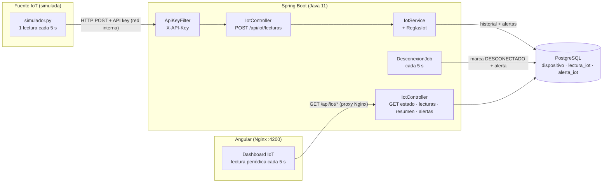
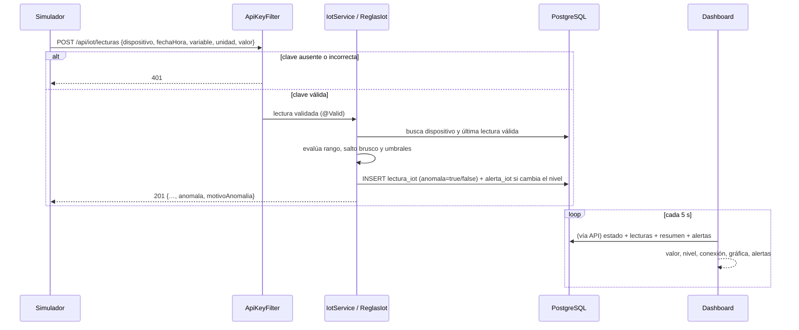

# P06 — Arquitectura Web 4.0 / IoT (PR05 Seguimiento de proyectos)

Una sola fuente IoT **simulada**: el sensor `sensor-lab-01` mide la **temperatura (°C)** del laboratorio donde trabaja el equipo.

## 1. Diagrama de flujo de datos

## 2. Recorrido de una lectura

## 3. Modelo de datos (Flyway `V3__iot.sql`)

| Tabla | Campos principales |
|---|---|
| `dispositivo` | `codigo` (único), `nombre`, `variable`, `unidad`, `proyecto_id` → `proyectos`, `frecuencia_seg`, `conexion` (`SIN_DATOS`/`CONECTADO`/`DESCONECTADO`), `ultima_lectura` |
| `lectura_iot` | `dispositivo_id`, **`fecha_hora`**, **`variable`**, **`unidad`**, **`valor`**, `anomala`, `motivo_anomalia`; índice `(dispositivo_id, fecha_hora DESC)` para la consulta temporal |
| `alerta_iot` | `dispositivo_id`, `lectura_id`, `tipo`, `severidad`, `mensaje`, `fecha_hora`; índice por fecha |

Las horas se guardan en UTC (`TIMESTAMP` + `hibernate.jdbc.time_zone=UTC`). El dispositivo queda ligado al primer proyecto de la tabla `proyectos` (`proyecto_id`), que es el vínculo con el PR05 ampliado.

## 4. Frecuencia

- El sensor envía **cada 5 s** (`INTERVALO_SEG`, y `frecuencia_seg = 5` en la tabla `dispositivo`): ≈ 720 lecturas/hora, 17 280/día (≈ 1 MB/día), cifra manejable sin purga para el alcance del curso.
- El dashboard consulta con el **mismo periodo (5 s)**: más rápido no aportaría datos nuevos y más lento perdería inmediatez.
- Consulta temporal: `GET /api/iot/lecturas?desde=&hasta=&limite=` (hasta 2000 puntos ≈ 2.7 h; rango máximo 7 días).

## 5. Datos anómalos

Una lectura se **acepta, se guarda marcada** (`anomala = true` + motivo) y **no cuenta** para el nivel actual, el promedio ni la línea de la gráfica. Así queda evidencia del fallo del sensor sin contaminar el análisis.

| Regla | Condición | Motivo guardado |
|---|---|---|
| Fuera de rango físico | valor < −10 °C o > 80 °C | `FUERA_DE_RANGO` |
| Salto brusco | \|valor − última lectura válida\| > 8 °C | `SALTO_BRUSCO` |

Además se **rechazan (400)** lecturas con variable/unidad distintas a las del dispositivo, JSON inválido, campos desconocidos, fecha-hora en el futuro (> 60 s) o con más de 24 h.

## 6. Niveles y alertas

| Nivel (lecturas válidas) | Umbral | Alerta que se genera (solo al **cambiar** de nivel) |
|---|---|---|
| OK | < 30 °C | `NORMALIZACION` (severidad INFO) al volver desde advertencia/crítico |
| ADVERTENCIA | ≥ 30 °C | `ADVERTENCIA` |
| CRITICO | ≥ 35 °C | `CRITICA` |

Alertas adicionales: `ANOMALIA` (por cada lectura anómala), `DESCONEXION` (crítica) y `RECONEXION` (info). Generar la alerta solo en la transición evita repetirla cada 5 s mientras el valor permanece alto.

**Respuesta visible en el dashboard:** banner rojo (crítico), ámbar (advertencia) o rojo de desconexión, insignias con **texto además de color**, tabla de alertas y marcas ✕ rojas en la gráfica.

## 7. Desconexión

El sensor deja de enviar → no llega ninguna petición que lo delate, por eso un planificador (`DesconexionJob`, cada 5 s) compara `ultima_lectura` con el reloj del servidor. Si pasan **más de 15 s (3 periodos)** sin datos: `conexion = DESCONECTADO` + alerta `DESCONEXION`. Al llegar la siguiente lectura vuelve a `CONECTADO` + alerta `RECONEXION`. El dashboard calcula «hace N s» con la hora del servidor (`ahora`), no con la del navegador, y corta la línea de la gráfica en el hueco.

## 8. Control de seguridad

| Amenaza | Control |
|---|---|
| Alguien envía lecturas falsas | Cabecera `X-API-Key` verificada por `ApiKeyFilter` **antes** de leer o validar el cuerpo; comparación en tiempo constante (`MessageDigest.isEqual`); 401 sin detalles |
| Exposición de la ingesta en la web pública | Nginx responde **403** a `POST /api/iot/lecturas` en el puerto 4200; el simulador entra por la red interna de Docker (`backend:8080`) |
| Clave en el repositorio | Se inyecta con `IOT_API_KEY` (`.env`, ignorado por Git; `.env.example` como plantilla). El valor por defecto solo sirve para el entorno local |
| Datos maliciosos o corruptos | Validación `@Valid`, tipos estrictos, campos desconocidos rechazados, rangos de fecha, límites de consulta (1–2000 y 1–200) |
| Fuga de información en errores | Cuerpo de error uniforme sin trazas; 500 genérico; el detalle solo va al log |
| Inyección SQL | Consultas derivadas de Spring Data (parametrizadas); restricciones `CHECK` en BD |
| Contenedores | Backend y simulador corren con usuario no root |

**Límites conocidos (documentados, fuera del alcance):** una sola clave compartida por el dispositivo (sin rotación ni clave por dispositivo), tráfico sin TLS en local (en producción iría detrás de HTTPS), las consultas de lectura no requieren autenticación y no hay *rate limiting*.
